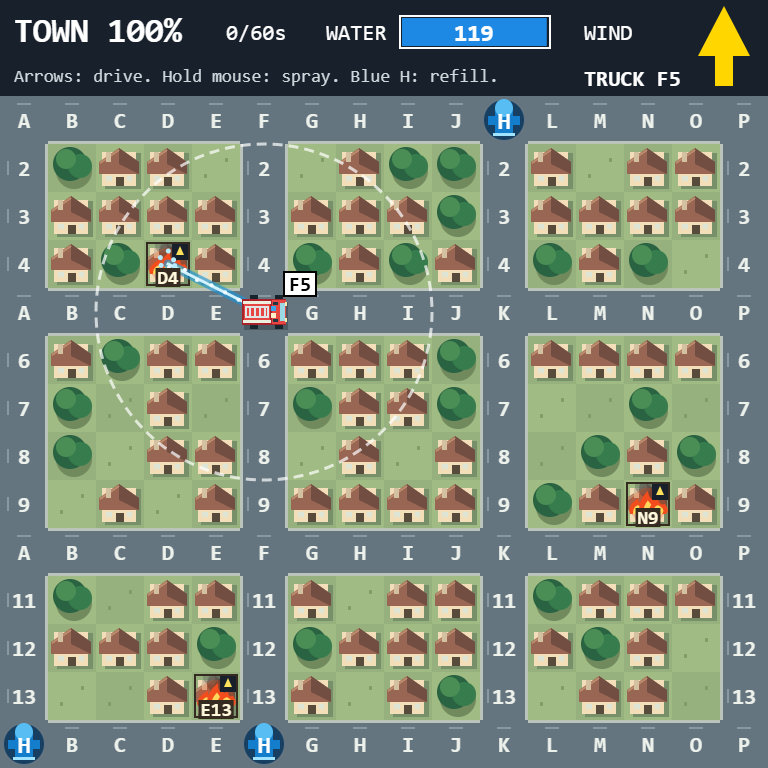
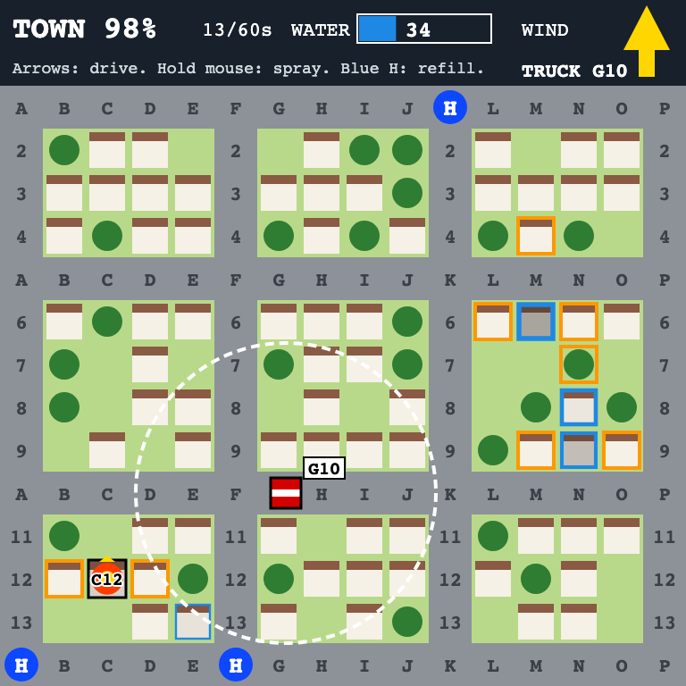
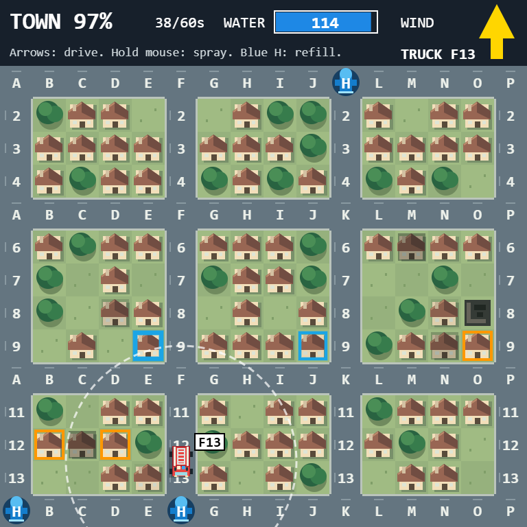
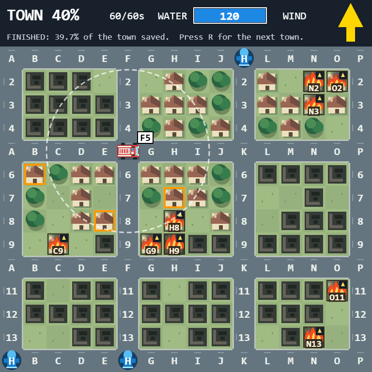
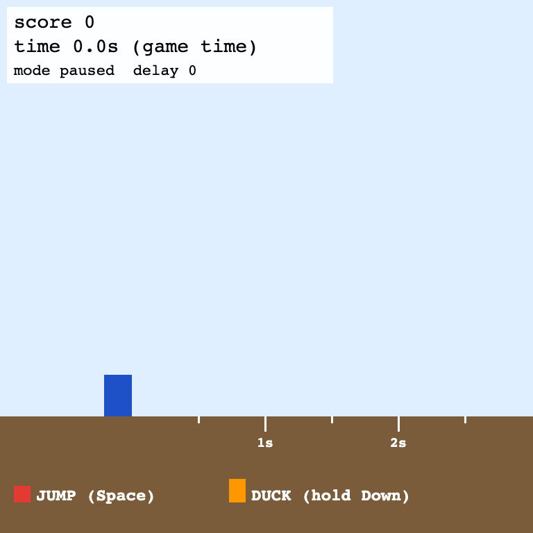
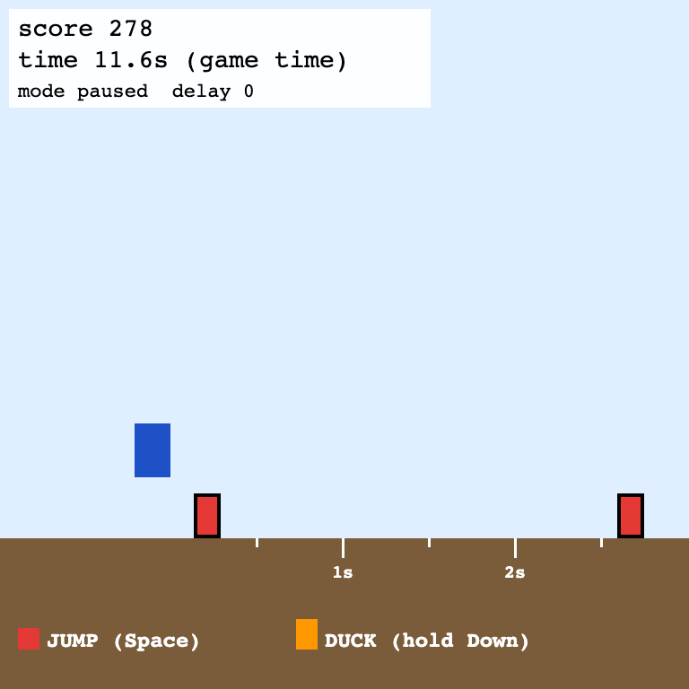
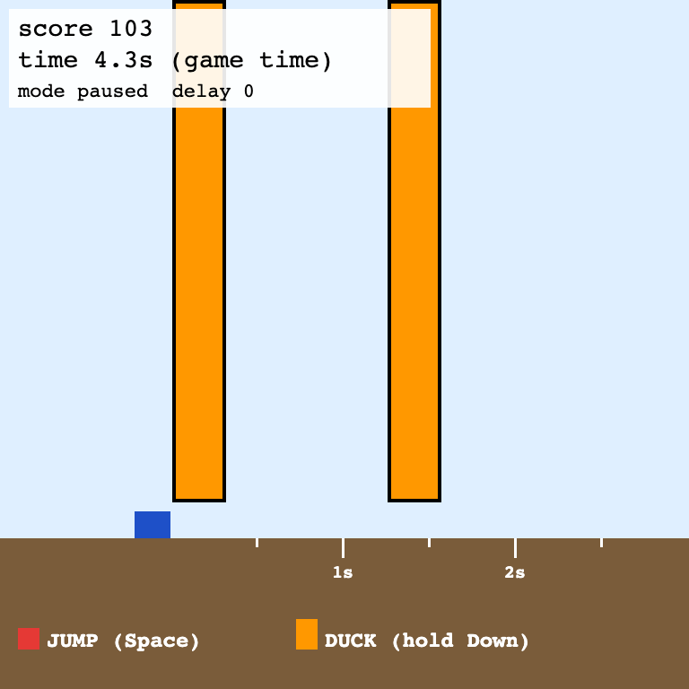
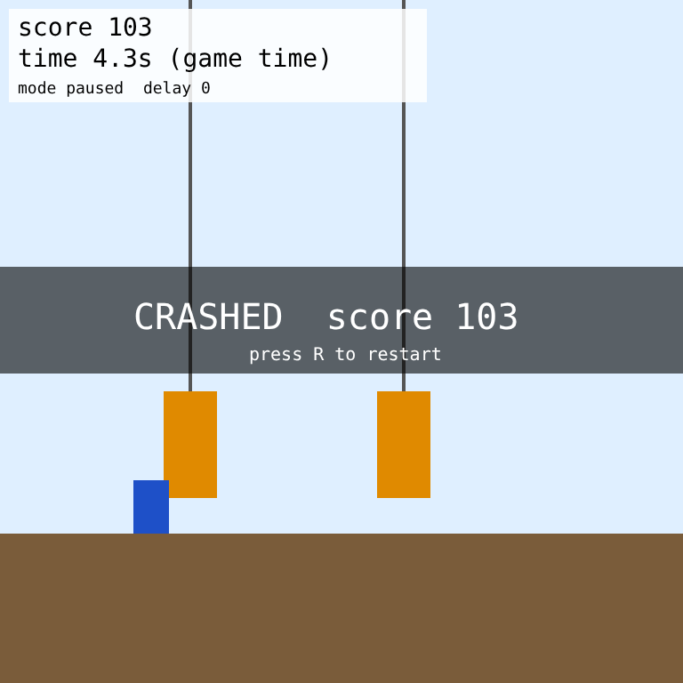

# Nash's game environments

Game environments for the GStar Bootcamp 2026 team project (LLMs that sense, think and act in realtime).

| game | what you do | input | why it is here |
|---|---|---|---|
| [Fireline v0](https://gstar-2026-team-project.github.io/nash-games/fireline-v0/) ([code and env API](fireline-v0/README.md)) | Drive a fire truck and spray water while fires spread with the wind. Save as much of the town as you can. | arrows + mouse | The general task: reflex, routing and priorities at the same time. Being slow costs a little at a time. |
| [Runner v0](https://gstar-2026-team-project.github.io/nash-games/runner-v0/) ([code and env API](runner-v0/README.md)) | Jump over boxes, duck under bars. | two keys | The simple calibration task: pure reaction, one mistake ends the run. |

Both games run in two modes, and every agent is measured in both:
- **Paused:** the game freezes after every frame and waits for the agent. Thinking is free.
- **Live:** the game keeps running while the agent thinks. One second of thinking = 24 ticks of the world moving on.

The gap between the two is the cost of thinking time.

## Game: Fireline v0

A small town seen from above. Fires start on their own, grow, and spread to their neighbours: fastest downwind, and the wind turns during the game. You drive on the streets (arrow keys), spray with the mouse (hold the button; the water reaches 3.5 cells), and refill at a hydrant. The tank is small, so you cannot save everything. Score = percent of the town still standing after the run. Screen 768×768, 24 ticks per second, three levels.

| start | fighting | later | nobody played |
|---|---|---|---|
|  |  |  |  |

What it asks of a player, all at once:
- **Under half a second:** aim the water, stop spraying when the fire is out.
- **A few seconds:** pick a route on the street grid, stand where the water reaches.
- **Tens of seconds:** which fire first, what to soak before it burns, when to drive back for water.
- **Things you cannot know at the start:** where the next fire starts, when the wind turns.

Everything a player needs is drawn: cell names on every street and on every fire, the truck's cell on a tag, the water left as a number, a wedge on each fire showing where the wind pushes it.

## Game: Runner v0

The player runs on its own. Jump over **red boxes** (Space), duck under **orange bars** (hold Down). Score = ticks survived; touching anything ends the run. A time ruler on the ground shows when each obstacle arrives.

| start | jump | duck | crash |
|---|---|---|---|
|  |  |  |  |

## Results

Three kinds of player, all on the same games and seeds:
- **Bot reading state**: a simple program that reads `env.state()` and waits a set time before acting. It measures latency alone.
- **Claude through `claude -p`**: a model that sees only the 384 px frame and answers with a short line of text, about 1 to 4 s per look (`harness/sight.js`).
- **Claude subagent**: a Claude Code subagent that plays through a small local server with curl and by reading the saved frames, 7 to 17 s per look (`harness/sight-server.js`).

### Fireline v0

Score = percent of the town still standing after 60 s at level 2, mean of seeds 1–3. Doing nothing keeps 45%.

| player | time per look | paused | live, 24 ticks/s |
|---|---|---|---|
| bot reading state, presses now | 0 / 0.25 / 1 / 4 s | 97% | 96% / 87% / 63% / 51% |
| bot reading state, sends a plan that allows for its own delay | 0 / 0.25 / 1 / 4 s | 97% | 90% / 82% / 76% / 55% |
| Haiku from screenshots, one action per look | 1.1–1.3 s | 87% | 59% |
| Haiku from screenshots, a plan per look | 2.4–3.7 s | 78% | 57% |
| Opus with thinking from screenshots, a plan per look | 3.9 s | not run | 55% |
| Haiku plans + Opus notes in parallel (hybrid) | 3.1 s | not run | 53% |
| Claude subagents by sight (Sonnet, Opus, Haiku; 6 games) | 7–17 s | 90–95% | 39–63% |

Full tables: [bots](fireline-v0/results.md), [Claude from screenshots](fireline-v0/results-sight.md). Subagent games used seeds 4–8 and one game each, so they are a rough guide, not a matched comparison. Two subagents also played live at 6 ticks/s (a quarter speed): 55% and 57%.

What it shows:
- **Every Claude setup loses about a third of its paused score when the game does not wait.** The live scores sit on the bot's delay curve: Haiku at about 1.3 s per look scores like the bot at 1 s. Live, the time per look decides the score more than which model looks.
- **Planning only pays when the plan allows for the delay.** A plan made from a frame that is 2 s old, with spray times for the fires as they were, did no better than doing nothing (44%). Adding the fire's growth during the delay raised it to 74%.
- **The hybrid in its first form does not help** (53% vs 57% for the plans alone). The slow model's note arrives every few seconds as free text; the fast model does not use it much. This is the first architecture to improve.

### Runner v0

| player | paused | live, 12 ticks/s | live, 24 ticks/s |
|---|---|---|---|
| bot reading state, presses now, 0.25 s thinking | 100% | 48% | 21% |
| bot reading state, sends a timed plan, 1 s thinking | 100% | 100% | 100% |
| Haiku from screenshots, one button per look | 100% | 34% | 21% |
| Haiku from screenshots, a timed plan per look | 99% | 63% | 38% |
| Sonnet with thinking from screenshots, a timed plan per look | 100% | 73% | 21% |

21% = crashed at the first obstacle. 20 s runs, seeds 1–3. Full tables: [bots](runner-v0/results.md), [Claude from screenshots](runner-v0/results-sight.md). An obstacle is visible only about 2.7 s before it hits, and a model needs most of that to answer, so at 24 ticks/s every slow player dies at the same place and they all look alike.

## What we learned

- **Paused numbers say nothing about live play.** In both games every Claude setup is near the top when paused and far below it live.
- **Instant death hides differences; a score that falls gradually shows them.** In Runner all slow agents get the same 21%. In Fireline each agent and each delay gets its own number.
- **For Claude the limit is time per look, not depth of reasoning.** Haiku solved 10-step arithmetic and turn-by-turn puzzles in about 1.2 s (15/16 or better), so adding a puzzle to a reflex game would not make a fast model lose. The thinking has to be about the game itself.
- **A plan made from an old frame goes wrong in two ways.** If the game skips the part of the plan that is already in the past, a plan that is relative to where the player stood ("drive right 2 cells") ends up somewhere else. And the world has moved on: a fire is bigger than it looked. A planner has to know its own delay.
- **Models misname what they have to count.** Playing by sight, Sonnet and Opus were off by one column for fires inside a block. Printing the name on the thing itself fixed most of it.

## Open questions

- Fireline: how should a fast and a slow model share the work so the slow one helps? Ideas from the subagents themselves: the fast loop keeps the truck busy (spray the nearest fire, refill when low), the slow one picks which block to defend.
- Is level 2 the right default, or should level 3 (greedy bot about 71, nobody about 2) be the headline?
- Which clock for training: wall clock, or a reproducible token clock / latency injection?
- Human baseline: the pages now list a person's finished runs under the game; still to be collected.

## Literature review (short)

A short version for this repo. The full review is [huikang-literature-review](https://github.com/gstar-2026-team-project/huikang-literature-review).

**1. The loop.** A game or computer-use agent runs *frame → think → action*, again and again.

**2. The problem.** Most benchmarks let the world wait while the model thinks. A real game does not: at 24 FPS, 2 s of thinking means 48 frames missed.

**3. How people deal with it.**

| idea | how | example |
|---|---|---|
| Think less | reason only at key moments, act directly otherwise | [Game-TARS](https://arxiv.org/abs/2510.23691) (sparse thinking). On Doom, no thinking scored 13.2 and thinking every step 7.2 |
| Don't think | map video straight to actions, no LLM | [VPT](https://arxiv.org/abs/2206.11795), [FDM-1](https://si.inc/posts/fdm1/) (company claims only) |
| Two loops | a reasoning model plans in the background; a fast non-reasoning model acts before each deadline | AgileThinker in [RealtimeGym](https://arxiv.org/abs/2511.04898): under rising time pressure 0.90 → 0.58, vs planning alone 0.92 → 0.05 |
| Action chunking | send a short plan, keep thinking while it runs | [Real-time chunking](https://arxiv.org/abs/2506.07339) (robotics): robots keep working with over 300 ms of model latency |

**4. How results are measured.**
- **Paused:** the game waits for every action. Game-TARS, VPT and SpeedrunBench (scored in frames, its main results are offline action tapes) run this way.
- **Live:** the game moves on while the model thinks, by wall clock or by a token budget (RealtimeGym uses text observations and a token clock).
- The gap between the two is the cost of thinking time. Runner v0 measures both for the same agent.

**5. Gaps this game can fill.**
- Most game-agent results are paused. Live results with **pixels** and low-level buttons on tasks that are easy for humans are rare.
- Action chunking has not been tested for LLM game agents. The env supports it directly (`setPlan`).
- Post-training against a live clock is open.
