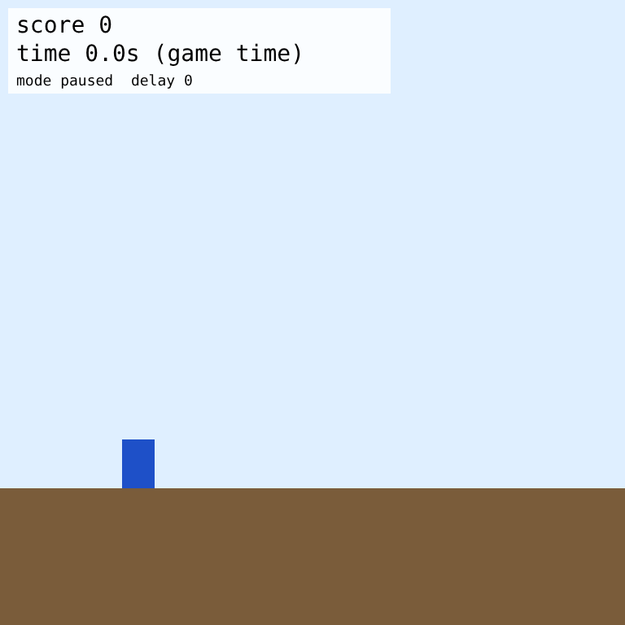
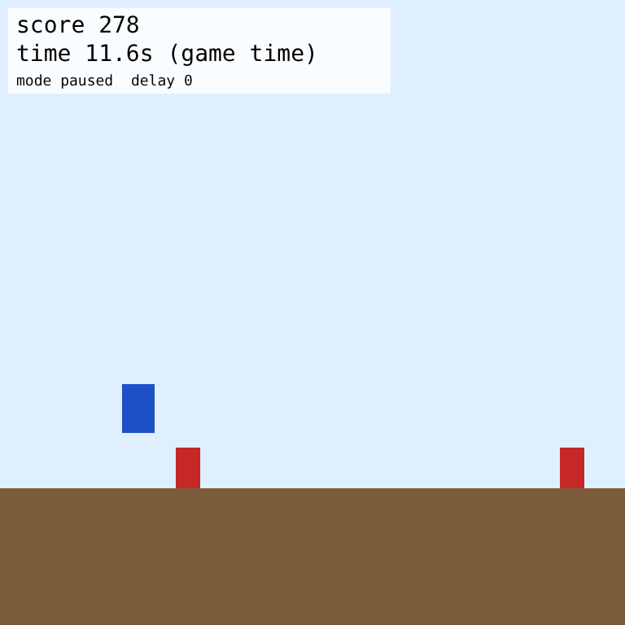
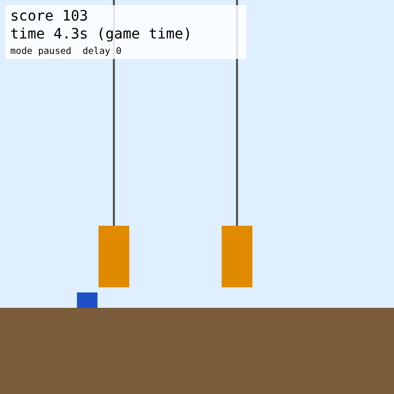
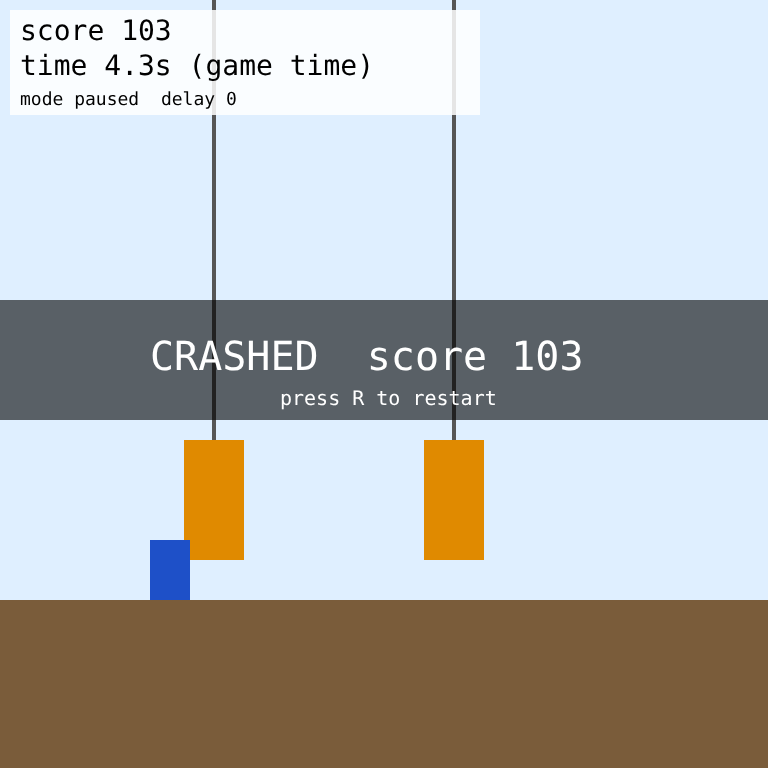

# Runner v0

A tiny HTML game for testing our env interface before we build the real game. It is a draft for team discussion (meeting 2026-11-11).

The player runs automatically. **Red boxes**: jump (Space). **Orange hanging bars**: duck (hold Down). The score goes up 1 per tick; you lose when you touch anything. A run ends after 60 s of game time.

| start | jump | duck | crash |
|---|---|---|---|
|  |  |  |  |

## Try it

- **Play it yourself:** open `index.html` in a browser. Space = jump, Down = duck, R = restart.
  URL options: `index.html?seed=3&tps=12&delay=6` (seed, ticks per second, action delay in ticks).
- **Check the rules (no browser):** `node test.js`
- **Check the page (keyboard, click, clock):** `node browser-test.js`
- **Paused vs live experiment:** `node play.js` (about 5 minutes; writes `results.md`)

The last two need Playwright: `npm install playwright && npx playwright install chromium`.

## The interface (what an agent sees and does)

It follows the pending team interface: frames at a regular interval, actions at the same interval, and an action is a click and/or buttons.

- **One tick = 1/24 s** of game time.
- **What the agent sees:** the 768×768 canvas, as a screenshot. For debugging, and for simple bots, `env.state()` also returns the same information as numbers.
- **An action:** `{ buttons: [...], click: [x, y] or null }`.
  - Buttons: `up down left right space x y`.
  - This game only uses `space` and `down`. Other buttons and clicks are accepted and logged, but do nothing here.
- **Two modes:**

| mode | the game clock | how the agent acts |
|---|---|---|
| `paused` | waits for the agent; thinking is free | `env.step(action)`: one tick per call |
| `live` | runs on its own at `tps` ticks/s (24 = normal) | `env.setAction(action)`: held until the next call. Or `env.setPlan(steps, fromTick)`: a timed list such as "wait 10 ticks, then jump". `fromTick` is the tick of the frame the plan was made from, and the game skips the part that is already in the past. |

- **Other knobs:**
  - `actionDelay`: an action takes effect N ticks later. This is Huikang's "act X frames in advance".
  - `seed`: the same seed with the same actions gives exactly the same game.
- **Tape:** `env.tape()` returns every action the game received, one per tick. Replaying a tape in paused mode reproduces a live run exactly; this is checked for every run in `play.js`.

## First result: thinking time only hurts when the game does not wait

Both bots read the numbers (`env.state()`) and are perfect when given time; neither is an LLM. "Think" is a fake wait standing in for an LLM call. The runs are 20 s long with 3 seeds; the full table is in `results.md`.

| bot | game clock | think 0 ms | 250 ms | 1 s | 2 s |
|---|---|---|---|---|---|
| any bot, **paused** | waits | 100% | 100% | 100% | 100% |
| rule bot (presses now), live | 24 ticks/s | 100% | 21% | 21% | 21% |
| planner bot (sends a timed plan), live | 24 ticks/s | 100% | **100%** | **100%** | 28% |
| planner bot, live | 12 ticks/s (half speed) | 100% | 100% | 100% | **100%** |

21% means the bot crashed into the first obstacle, the same score as doing nothing.

What this shows:
1. **Paused results say nothing about live play.** The same bot goes from 100% to 21% with only 0.25 s of thinking. Game-TARS and SpeedrunBench report paused or offline numbers.
2. **Plans (macros) rescue slow thinkers.** "Wait 10 ticks, then jump" works with 1 s of thinking. "Jump now" does not work even at 0.25 s.
3. **The limit is how far ahead you can see.** An obstacle is visible about 3 s before it arrives at 24 ticks/s. With 2 s of thinking, new obstacles appear while the bot is still thinking about the old frame, so it fails. At half speed it has 6 s of look-ahead and is fine.
   - Rough rule: **look-ahead must be more than about 2× the thinking time.** This is the dial that makes the game "hard for slow models".
   - A frontier LLM call is about 1–3 s, which is right at this edge.

## Rules in numbers (all in `game.js`)

- Player: 40×60 px (30 px tall when ducking) at x = 150.
- Jump: 16 px/tick up, gravity 1.2, so about 1.1 s in the air and 106 px high.
- Obstacles move 8 px/tick (192 px/s). A new one comes every 1.25–2.5 s, and each is a box or a bar with 50/50 odds.
- A jump has a timing window of about 0.4 s. A bar must be ducked under for its whole pass (about 0.5 s).

## Files

| file | what |
|---|---|
| `game.js` | the rules only: `newGame`, `step`, `getState` (~150 lines, no drawing) |
| `index.html` | drawing, keyboard, live clock, and the `env` API |
| `bots.js` | idle, random, rule and planner bots |
| `test.js` | 8 rule checks, no browser |
| `browser-test.js` | 5 page checks: keyboard, clock, click, late plan, paused mode |
| `play.js` | the paused vs live experiment → `results.md` |

## Questions for the team

1. Do we keep **both modes** (paused and live) in the interface? I think yes: the gap between them is the measurement.
2. Should **plans/macros** (`setPlan`) be part of the standard interface, or only something a harness builds on top?
3. What does the LLM get? A screenshot every k ticks (cost: ~1k+ tokens per frame), a short clip, or numbers? These bots cheat by reading numbers.
4. Next step: plug in a real model (frontier plus a small open model) as the "think" step. Then, the arena game with click + all 7 buttons.

Known limits:
- Live timing has some noise; the same setting can vary by a few ticks between runs.
- The first obstacle always comes at the same time; only its type changes with the seed.
